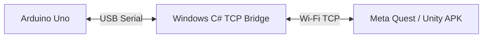

# VR HW3 — Arduino 與 Meta Quest 雙向通訊

## 實驗目的

- Arduino → Unity：旋轉實體可變電阻，控制 VR 儀表板指針平滑旋轉。
- Unity → Arduino：使用 VR 控制器選取 LED ON／OFF 按鈕，控制實體 LED 亮滅。

## 系統架構



因電腦 GPU 不支援 Horizon Link，本實驗改用 Meta Quest 獨立執行 Android APK，透過 Windows TCP Bridge 與 Arduino 雙向通訊。此替代架構與原題 PC-based VR 略有不同，須由助教確認是否接受。

## 硬體接線與通訊

| 元件 | Arduino 腳位 |
|---|---|
| 可變電阻 | 5V、A0（中間腳）、GND |
| LED | D4（串聯限流電阻）、GND |

Serial：COM5、9600 baud；TCP：8888。

Arduino 每 50 ms 傳送 `POT:數值`（0～1023），Unity 將其轉換為指針角度。VR 按鈕傳送 `LED:1` 或 `LED:0` 控制 LED，每筆訊息以換行結尾。

## 執行方式

1. 上傳 Arduino 程式，接上 USB 並關閉 Serial Monitor。
2. 確認電腦與 Meta Quest 位於可互通的區域網路。
3. 在 Repository 根目錄使用 Windows PowerShell 啟動 Bridge（需 .NET SDK）：

   ```powershell
   dotnet run --project .\Bridge\ArduinoBridge.csproj -c Release -- COM5 9600 8888 192.168.0.144
   ```

4. 使用 Unity 6 開啟 `Unity/` 專案，在 ArduinoManager 設定 Tcp Client、電腦實際 IPv4 與 Port 8888。上述 IP 為測試值，若網路改變須同步修改 Bridge 指令及 Unity 設定。
5. 儲存場景，停止 Play Mode，連接 Meta Quest，使用 Android Build And Run 安裝 APK。保持 Bridge 執行。

## 實驗結果

已成功驗證 Arduino 序列通訊、TCP Bridge、Unity Editor 連線及 Meta Quest 執行。頭盔內指針旋轉與 LED 亮滅為 Demo 驗收項目。

## 專案檔案

- `Arduino/`：Arduino 原始碼
- `Bridge/`：Windows C# 通訊橋接程式
- `Unity/`：Unity VR 專案
